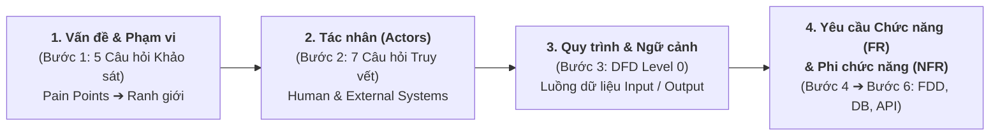

# TƯ DUY PHÂN TÍCH NGHIỆP VỤ: TỪ VẤN ĐỀ ĐẾN YÊU CẦU CHỨC NĂNG & PHI CHỨC NĂNG
> **Tài liệu nền tảng:** Giải thích chuỗi tư duy phân tích hệ thống (*Systems Thinking*)  
> **Trích dẫn trọng tâm:** *"Tuần 1–4: Học cách xác định vấn đề, phạm vi, tác nhân, quy trình nghiệp vụ, yêu cầu chức năng và phi chức năng."*

---

## 1. Ý nghĩa của Chuỗi Tư duy Phân tích Nghiệp vụ (Systems Thinking Chain)

Thứ tự các khái niệm trong câu trích dẫn trên **không phải là sự liệt kê ngẫu nhiên**, mà chính là **Chuỗi truy vết nhân quả (End-to-End Traceability)** từ khi phát hiện nỗi đau thực tế của doanh nghiệp cho đến khi định hình kiến trúc phần mềm hoàn chỉnh:

1. **Xác định Vấn đề & Phạm vi (Bước 1 — [`1-problem-survey.md`](./1-problem-survey.md)):**
   - Trả lời câu hỏi *Tại sao cần xây dựng hệ thống?* và *Hệ thống dừng lại ở ranh giới nào?* (ví dụ: chỉ làm Backend API Checklist tích hợp, không xây lại hệ thống chấm công hay tự quản lý phân quyền nội bộ).
2. **Xác định Tác nhân — Actors (Bước 2 — [`2-actor-identification.md`](./2-actor-identification.md)):**
   - Trả lời câu hỏi *Ai hoặc hệ thống ngoài nào trực tiếp tương tác với hệ thống?* (`ACT-01: Nhân viên`, `ACT-02: Quản lý`, `ACT-EXT-01: Hệ thống gốc SC24h`) và tách biệt rõ với *Tác vụ chạy ngầm (`JOB-01`)* hay *Thực thể dữ liệu thụ động (`Entity`)*.
3. **Xác định Quy trình Nghiệp vụ & Luồng Ngữ cảnh (Bước 3 — [`3-dfd-context-diagram.md`](./3-dfd-context-diagram.md)):**
   - Trả lời câu hỏi *Từng tác nhân gửi dữ liệu gì vào (Input) và nhận kết quả gì ra (Output) theo trình tự nào?*
4. **Xác định Yêu cầu Chức năng (FR) & Yêu cầu Phi chức năng (NFR) (Bước 4 $\to$ Bước 6):**
   - Mở hộp đen hệ thống để xác định đầy đủ các tính năng cần có (**FR**) và các tiêu chuẩn kỹ thuật/chất lượng bắt buộc (**NFR**).

---

## 2. Phân biệt Yêu cầu Chức năng (FR) và Yêu cầu Phi chức năng (NFR)

| Tiêu chí so sánh | Yêu cầu Chức năng (Functional Requirements - FR) | Yêu cầu Phi chức năng (Non-Functional Requirements - NFR) |
|---|---|---|
| **Câu hỏi cốt lõi** | Hệ thống **làm được những việc gì** cho người dùng? (*What the system does*) | Hệ thống vận hành các việc đó **nhanh, an toàn, ổn định và tốt đến mức nào**? (*How well the system performs*) |
| **Góc nhìn tiếp cận** | Góc nhìn của **Người dùng & Nghiệp vụ** (tính năng thao tác được, gọi API trả về kết quả nghiệp vụ). | Góc nhìn của **Kiến trúc sư Hệ thống (System Architect)** (hiệu năng, độ trễ, bảo mật, khả năng chịu tải, toàn vẹn dữ liệu). |
| **Cách biểu diễn trong dự án** | Cụm `Động từ + Danh từ` theo nhịp `Input ➔ Process ➔ Output` trên **Cây chức năng FDD (Bước 4)**. | Các quy tắc kiến trúc, ràng buộc thời gian phản hồi, cơ chế đồng bộ/bất đồng bộ, Index DB, Guard bảo mật (`.agents/rules/*`). |
| **Tác động tới Thiết kế** | Quyết định hệ thống có **bao nhiêu Bảng Database** và **bao nhiêu API Endpoint**. | Quyết định **cấu trúc bên trong Bảng Database** (Index, bảng tổng hợp Cron) và **luồng xử lý Code** (thứ tự gọi API, lọc XSS, chặn xóa `409`). |
| **Hệ quả nếu thiếu** | Phần mềm **thiếu tính năng**, không giải quyết được bài toán nghiệp vụ của khách hàng. | Phần mềm có đủ tính năng nhưng **không thể vận hành thực tế** (chậm treo, sai lệch giờ chấm công, lộ dữ liệu). |

---

## 3. Minh họa Thực tế ngay trong Dự án Project TimeKeeper

Sự kết hợp giữa **Yêu cầu Chức năng (FR)** và **Yêu cầu Phi chức năng (NFR)** thể hiện trực tiếp qua các quyết định kiến trúc của dự án **TimeKeeper**:

### 3.1. Yêu cầu Chức năng (Functional Requirements - FR) trong TimeKeeper
Tương ứng với 9 chức năng Cấp 2 (`FDD-01` $\to$ `FDD-09`) tại [`4-fdd-and-rbac.md`](./4-fdd-and-rbac.md):
- **`FDD-01` & `FDD-02`:** Kiểm tra nghĩa vụ nộp báo cáo Checklist (`require_checklist`) và kiểm tra quyền xem báo cáo (`can_view_report`) qua API Hệ thống gốc.
- **`FDD-03`:** Nhân viên tạo, sửa, xóa, xem danh sách công việc mẫu cá nhân (*Template Task*).
- **`FDD-04`:** Nhân viên thực hiện Check-in và chọn từ Template Task hoặc tạo mới danh sách công việc cần làm trong ngày.
- **`FDD-05`:** Nhân viên thực hiện Check-out và cập nhật `% tiến độ hoàn thành (0% – 100%)` hoặc trạng thái `chưa làm`.
- **`FDD-06`:** Nhân viên tra cứu lịch sử Checklist các ngày/tuần trước của bản thân.
- **`FDD-07` & `FDD-08`:** Quản lý xem danh sách công việc, tiến độ trong ngày và báo cáo thống kê tuần/tháng của cá nhân/phòng ban.
- **`FDD-09`:** Hệ thống tự động tổng hợp số liệu tiến độ vào cuối mỗi ngày.

---

### 3.2. Yêu cầu Phi chức năng (Non-Functional Requirements - NFR) trong TimeKeeper
Chính các yêu cầu phi chức năng dưới đây đã định hình lại luồng xử lý thực tế của dự án:

1. **Tính Tức thời & Độ trễ thấp khi Chấm công (Timeliness & Low Latency):**
   - **Bài toán thực tế:** Nếu bắt nhân viên ngồi gõ xong danh sách công việc (mất 5–10 phút) rồi mới gọi API chấm công thì vẫn "đúng chức năng", nhưng **vi phạm nghiêm trọng yêu cầu phi chức năng về độ chính xác thời gian chấm công** (nhân viên bị tính đi muộn).
   - **Giải pháp kiến trúc:** Khi nhân viên bấm Check-in / Check-out, Backend TimeKeeper bắt buộc **gọi ngay lập tức API chấm công của Hệ thống gốc** để chốt thời gian chuẩn xác trước; việc chọn/tạo task hoặc cập nhật % tiến độ tách thành hành động độc lập.

2. **Tính Cô lập Lỗi & Độ tin cậy (Fault Isolation & Reliability):**
   - **Yêu cầu:** Mọi thao tác tạo task, sửa template hay cập nhật tiến độ trên TimeKeeper **tuyệt đối không được gây ảnh hưởng, làm chậm hoặc làm gián đoạn Hệ thống Chấm công gốc** của công ty SC24h.

3. **Hiệu năng Truy vấn Báo cáo Chu kỳ (Query Performance & Scalability):**
   - **Yêu cầu:** Khi Quản lý xem báo cáo thống kê theo tuần/tháng (`FDD-08`), kết quả phải trả về nhanh chóng mà không phải quét và tính toán lại toàn bộ bản ghi thô mỗi lần gọi API.
   - **Giải pháp kiến trúc:** Thiết kế **Cron Job chạy ngầm cuối mỗi ngày (`JOB-01` / `FDD-09`)** để tổng hợp sẵn số liệu vào bảng `daily_report_summaries`, kết hợp đánh Index trên MongoDB (`user_id`, `work_date`, `unsign_search`).

4. **Bảo mật & Toàn vẹn Dữ liệu (Security & Referential Integrity):**
   - **Phân quyền & Cô lập dữ liệu:** Nhân viên chỉ được thao tác trên dữ liệu của chính mình (`Scope: OWN`); quyền xem báo cáo của Quản lý bắt buộc xác thực qua API gốc (`can_view_report = true`).
   - **Chống mã độc (XSS Sanitization):** Toàn bộ nội dung chuỗi do người dùng nhập vào (tên task, mô tả, ghi chú) phải đi qua hàm làm sạch `sanitizeContent` trước khi lưu Database.
   - **Toàn vẹn tham chiếu (`409 Conflict`):** Không cho phép xóa cứng bản ghi nguồn (như `task_templates`) nếu đã được tham chiếu trong lịch sử `daily_checklists`, mà yêu cầu chuyển sang khóa mềm (`status = 0`).

---

## 4. Kết luận Tóm tắt

- **Yêu cầu Chức năng (FR)** tạo nên **"Phần xác" (Tính năng nghiệp vụ)** — giúp phần mềm làm đúng việc người dùng cần.
- **Yêu cầu Phi chức năng (NFR)** tạo nên **"Phần hồn & Sức chịu tải" (Kiến trúc kỹ thuật)** — giúp phần mềm vận hành nhanh, chính xác, an toàn và bền vững trong môi trường thực tế.

