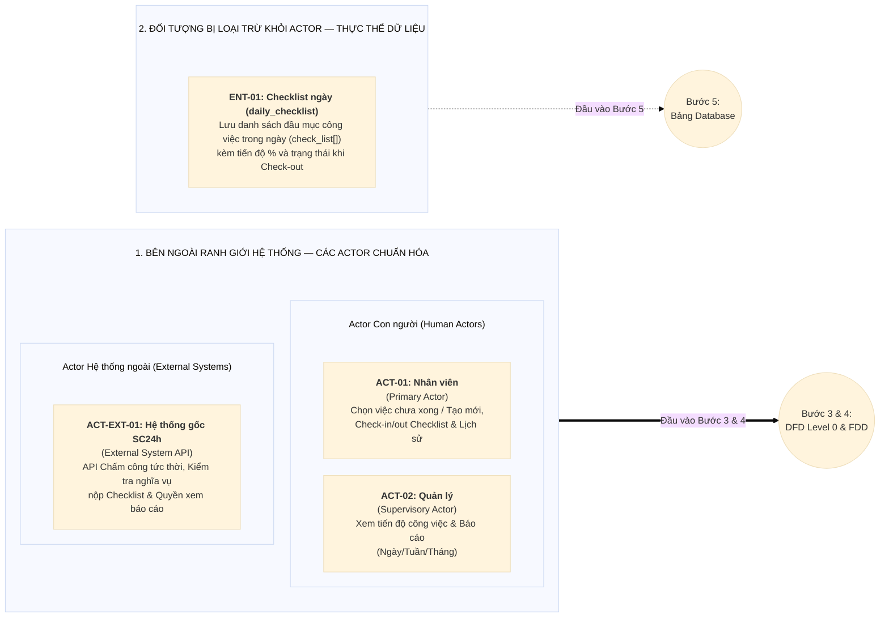

# BƯỚC 2: TRUY VẾT & BÓC TÁCH TÁC NHÂN (ACTOR IDENTIFICATION)
> **Dự án:** Project TimeKeeper (Module Quản lý Checklist Công việc tích hợp Chấm công)  
> **Đầu vào:** [`md/analysis/1-problem-survey.md`](./1-problem-survey.md)  
> **Đầu ra phục vụ:** Bước 3 (DFD Level 0), Bước 4 (FDD & RBAC), Bước 5 (Database Design)

---

## 1. Bảy Câu hỏi Truy vết Actor (Từ Kết quả Khảo sát Bước 1)

### Câu 1: Ai trực tiếp đưa dữ liệu mới vào hệ thống? (Primary Actor)
* **Nguồn truy vết:** Câu 2 (Quy trình chấm công & khai báo việc) và Câu 4 (Nhóm đối tượng sử dụng) ở Bước 1.
* **Kết quả phân tích:**
  * **`ACT-01: Nhân viên (Employee)`** *(thuộc diện phải nộp báo cáo checklist theo kết quả kiểm tra từ API hệ thống gốc)* là tác nhân chính trực tiếp khởi tạo và cập nhật dữ liệu công việc thông qua các thao tác nghiệp vụ:
    1. **Sau khi Check-in:** Tìm kiếm / chọn lại các công việc chưa hoàn thành từ những ngày trước để làm tiếp (tạo bản ghi mới cho ngày hôm nay) hoặc tự nhập các công việc mới cần làm trong ngày.
    2. **Khi Check-out:** Xem lại danh sách công việc ngày hôm nay và cập nhật kết quả theo **% tiến độ hoàn thành (`0% - 100%`)** và trạng thái (`TODO`, `PROGRESS`, `DONE`, `HOLD`, `CANCELLED`).

---

### Câu 2: Ai tiếp nhận, duyệt hoặc xử lý bước tiếp theo? (Secondary Actor)
* **Nguồn truy vết:** Câu 3 (Mục tiêu hệ thống) và Câu 4 ở Bước 1.
* **Kết quả phân tích:**
  * **Không có Secondary Actor duyệt thủ công.**
  * Hệ thống vận hành theo cơ chế tự khai báo và tự cập nhật (*Self-reporting*): Ngay sau khi Nhân viên (`ACT-01`) lập checklist lúc Check-in và chốt % tiến độ lúc Check-out, dữ liệu được hệ thống ghi nhận trực tiếp vào `daily_checklist` để phục vụ tra cứu và thống kê báo cáo.

---

### Câu 3: Ai xem báo cáo, giám sát và ra quyết định? (Supervisory Actor)
* **Nguồn truy vết:** Câu 4 (Ai sử dụng) và Câu 5 (Tiêu chí nghiệm thu báo cáo) ở Bước 1.
* **Kết quả phân tích:**
  * Áp dụng **Quy tắc 1 (Gộp chức danh trùng quyền)**: Ban Giám đốc và Quản lý các cấp có cùng hành vi trên phần mềm (xem báo cáo tiến độ ngày, tuần, tháng ở chế độ *Read-only*) nên được hợp nhất thành **01 Actor giám sát duy nhất**:
    * **`ACT-02: Quản lý (Manager)`** — Giám sát, xem danh sách công việc đang làm và tiến độ trong ngày của cá nhân / phòng ban, cũng như xem báo cáo thống kê tổng hợp công việc theo tuần, tháng (*Read-only*) khi API Hệ thống gốc xác nhận có quyền xem (`can_view_report = true`).

---

### Câu 4: Người dùng cuối tương tác trực tiếp hay gián tiếp & Đối tượng nào bị loại trừ thành Thực thể dữ liệu? (Self-service User vs Data Entity)
* **Nguồn truy vết:** Câu 2 và Câu 4 ở Bước 1.
* **Kết quả phân tích:**
  * **Tương tác trực tiếp (Self-service Users):** Chỉ gồm **02 Human Actors** tự thao tác trực tiếp với hệ thống (không có người nhập hộ):
    1. **Nhân viên (`ACT-01`):** Tự chọn/tạo task khi Check-in, tự cập nhật % tiến độ khi Check-out và xem lịch sử cá nhân.
    2. **Quản lý (`ACT-02`):** Trực tiếp truy vấn xem danh sách công việc trong ngày và báo cáo tiến độ tuần/tháng.
  * **Đối tượng thụ động bị loại trừ khỏi Actor (chuyển thành Thực thể dữ liệu - Data Entity cho Bước 5):**
    * `ENT-01: Checklist công việc ngày (Daily Checklist & Embedded Tasks)` — Bản ghi lưu trữ danh sách các đầu mục công việc làm trong ngày (`check_list[]`), mô tả, % tiến độ và trạng thái sau khi Check-out.

---

### Câu 5: Hệ thống có trao đổi dữ liệu tự động với bên thứ 3 nào không? (External System)
* **Nguồn truy vết:** Câu 1 (Ranh giới hệ thống tích hợp) và Câu 5 ở Bước 1.
* **Kết quả phân tích:**
  * Có **01 Actor Hệ thống ngoài**:
    * **`ACT-EXT-01: Hệ thống gốc SC24h (External Timekeeping & Permission API)`** — Giao tiếp hai chiều tự động qua API với Backend TimeKeeper để:
      1. Xử lý ghi nhận thời gian **Check-in / Check-out tức thời** ngay khi User bấm chấm công.
      2. Kiểm tra xem User có thuộc diện **phải nộp báo cáo Checklist** khi Check-in / Check-out hay không (`require_checklist`).
      3. Kiểm tra User có **quyền Quản lý xem báo cáo Checklist Task** hay không (`can_view_report`).

---

### Câu 6: Có nghiệp vụ nào tự động chạy ngầm theo thời gian/hàng đợi không? (Automated Process / Background Job)
* **Nguồn truy vết:** Quyết định thiết kế tối giản 1 Collection (`daily_checklist`).
* **Kết quả phân tích:**
  * **Không sử dụng Background Job / Cron Job.** Toàn bộ dữ liệu ghi chú công việc hàng ngày nằm gọn trên 01 Collection `daily_checklist` có đánh Index theo `employee_id`, `branch_id` và `date`, cho phép truy vấn trực tiếp theo thời gian thực (*Real-time query*).

---

### Câu 7: Ai quản trị tài khoản, phân quyền và cấu hình nền tảng? (System Admin)
* **Nguồn truy vết:** Câu 4 và quyết định kiến trúc `D3` ở Bước 1.
* **Kết quả phân tích:**
  * **Không có Actor `System Admin` trên hệ thống TimeKeeper.**
  * Toàn bộ việc quản lý tài khoản, cấu hình đối tượng phải nộp báo cáo Checklist khi Check-in/Check-out và phân quyền Quản lý xem báo cáo Checklist đều được quản lý tập trung bên **Hệ thống gốc SC24h (`ACT-EXT-01`)** và cung cấp cho TimeKeeper thông qua API.

---

## 2. Bảng Tổng hợp Các Thành phần Đã Chuẩn hóa

### 2.1. Danh sách Actor Chuẩn hóa (Đầu vào Bước 3 — DFD Level 0)

| Mã Actor | Tên Actor | Phân loại | Phạm vi Dữ liệu (Scope) | Trách nhiệm & Tương tác chính qua API |
|:---:|---|---|---|---|
| **`ACT-01`** | **Nhân viên (Employee)** | Human Actor (Primary) | `OWN` (Cá nhân) | - Tìm kiếm / chọn lại các công việc chưa xong trước đó hoặc tạo công việc mới khi **Check-in**. - Cập nhật **% tiến độ hoàn thành (0-100%)** và trạng thái khi **Check-out**. - Xem lịch sử Checklist các ngày/tuần trước của bản thân. |
| **`ACT-02`** | **Quản lý (Manager)** | Human Actor (Supervisory) | `API Verified` (`can_view_report = true`) | - Xem danh sách công việc và tiến độ trong ngày của cá nhân / phòng ban. - Xem báo cáo thống kê tiến độ công việc theo tuần, tháng (*Read-only*). |
| **`ACT-EXT-01`** | **Hệ thống gốc SC24h (External System API)** | External System Actor | `INTEGRATION` (Hệ thống tích hợp) | - Xử lý API Check-in / Check-out tức thời. - Cung cấp API kiểm tra User có phải nộp báo cáo Checklist không. - Cung cấp API kiểm tra User có quyền Quản lý xem báo cáo không. |

---

### 2.2. Danh sách Thực thể Dữ liệu Bị Loại trừ khỏi Actor (Đầu vào Bước 5 — Database)

| Mã Entity | Tên Thực thể Dữ liệu | Lý do không phải là Actor | Ánh xạ Collection (Bước 5) |
|:---:|---|---|---|
| **`ENT-01`** | **Checklist ngày (Daily Checklist)** | Bản ghi thụ động lưu trữ danh sách đầu mục công việc làm trong ngày (`check_list[]`), % tiến độ và trạng thái khi Check-out. | `daily_checklist` |

---

## 3. Sơ đồ Phân loại Actor & Ranh giới Hệ thống

