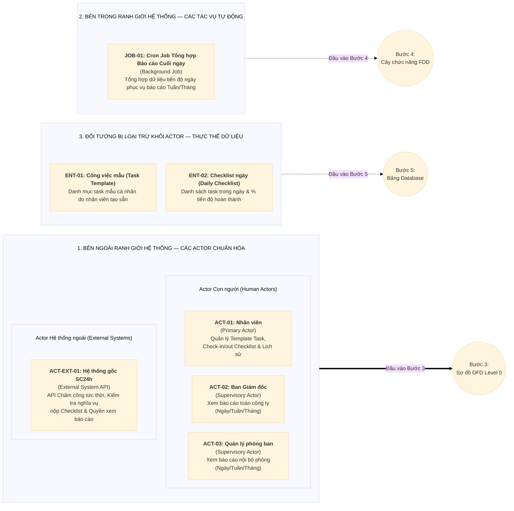

# BƯỚC 2: TRUY VẾT & BÓC TÁCH TÁC NHÂN (ACTOR IDENTIFICATION)
> **Dự án:** Project TimeKeeper (Module Quản lý Checklist Công việc tích hợp Chấm công)  
> **Đầu vào:** [`md/analysis/1-problem-survey.md`](./1-problem-survey.md)  
> **Đầu ra phục vụ:** Bước 3 (DFD Level 0), Bước 4 (FDD & RBAC), Bước 5 (Database Design)

---

## 1. Bảy Câu hỏi Truy vết Actor (Từ Kết quả Khảo sát Bước 1)

### Câu 1: Ai trực tiếp đưa dữ liệu mới vào hệ thống? (Primary Actor)
* **Nguồn truy vết:** Câu 2 (Quy trình chấm công & khai báo việc) và Câu 4 (Nhóm đối tượng sử dụng) ở Bước 1.
* **Kết quả phân tích:**
  * **`ACT-01: Nhân viên (Employee)`** *(thuộc diện phải nộp báo cáo checklist theo kết quả kiểm tra từ API hệ thống gốc)* là tác nhân chính trực tiếp khởi tạo và cập nhật dữ liệu công việc thông qua 3 thao tác nghiệp vụ:
    1. **Trước khi chấm công:** Tự tạo và quản lý danh sách **Template Task (công việc mẫu cá nhân)** thường xuyên thực hiện.
    2. **Sau khi Check-in:** Chọn nhanh công việc từ bộ Template Task có sẵn của cá nhân hoặc tự tạo mới các task phát sinh chưa có trong template để lập danh sách công việc (Daily Checklist) trong ngày.
    3. **Khi Check-out:** Xem lại danh sách công việc ngày hôm nay và cập nhật kết quả theo **% tiến độ hoàn thành (`0% - 100%`)** hoặc đánh dấu trạng thái **chưa làm**.

---

### Câu 2: Ai tiếp nhận, duyệt hoặc xử lý bước tiếp theo? (Secondary Actor)
* **Nguồn truy vết:** Câu 3 (Mục tiêu hệ thống) và Câu 4 ở Bước 1.
* **Kết quả phân tích:**
  * **Không có Secondary Actor duyệt thủ công.**
  * Hệ thống vận hành theo cơ chế tự khai báo và tự cập nhật (*Self-reporting*): Ngay sau khi Nhân viên (`ACT-01`) tạo/chọn task lúc Check-in và chốt % tiến độ lúc Check-out, dữ liệu được hệ thống ghi nhận trực tiếp để phục vụ tổng hợp và thống kê báo cáo mà không cần bước phê duyệt trung gian.

---

### Câu 3: Ai xem báo cáo, giám sát và ra quyết định? (Supervisory Actor)
* **Nguồn truy vết:** Câu 4 (Ai sử dụng) và Câu 5 (Tiêu chí nghiệm thu báo cáo) ở Bước 1.
* **Kết quả phân tích:**
  * Nhóm giám sát được tách thành **2 Actor độc lập** theo phạm vi dữ liệu (*Data Scope*) được xác thực từ API của Hệ thống gốc (cùng ở chế độ *Read-only*):
    1. **`ACT-02: Ban Giám đốc (BOD)`** — Giám sát, xem danh sách công việc và báo cáo thống kê tiến độ theo ngày, tuần, tháng của **toàn bộ các phòng ban** trong công ty (`API Scope: ALL`).
    2. **`ACT-03: Quản lý phòng ban (Department Manager)`** — Giám sát, xem danh sách công việc và báo cáo thống kê tiến độ ngày, tuần, tháng **trong phạm vi phòng ban mình quản lý** (`API Scope: DEPARTMENT`).

---

### Câu 4: Người dùng cuối tương tác trực tiếp hay gián tiếp & Đối tượng nào bị loại trừ thành Thực thể dữ liệu? (Self-service User vs Data Entity)
* **Nguồn truy vết:** Câu 2 và Câu 4 ở Bước 1.
* **Kết quả phân tích:**
  * **Tương tác trực tiếp (Self-service Users):** Toàn bộ các tác nhân con người đều tự thao tác trực tiếp với hệ thống (không có người nhập hộ):
    * **Nhân viên (`ACT-01`):** Tự quản lý Template Task cá nhân, tự chọn/tạo task khi Check-in, tự cập nhật % tiến độ khi Check-out và xem lịch sử cá nhân.
    * **Ban Giám đốc (`ACT-02`) & Quản lý phòng ban (`ACT-03`):** Trực tiếp truy vấn xem báo cáo, tiến độ công việc theo phạm vi quyền hạn được API hệ thống gốc xác nhận.
  * **Đối tượng thụ động bị loại trừ khỏi Actor (chuyển thành Thực thể dữ liệu - Data Entities cho Bước 5):**
    * `Công việc mẫu (Task Template)`: Dữ liệu mẫu do nhân viên tự tạo trước để tái sử dụng nhanh khi Check-in.
    * `Checklist ngày & Đầu việc (Daily Checklist / Task Item)`: Bản ghi công việc và % tiến độ gắn với từng ngày làm việc của nhân viên.

---

### Câu 5: Hệ thống có trao đổi dữ liệu tự động với bên thứ 3 nào không? (External System)
* **Nguồn truy vết:** Câu 1 (Ranh giới hệ thống tích hợp) và Câu 5 ở Bước 1.
* **Kết quả phân tích:**
  * Có **01 Actor Hệ thống ngoài**:
    * **`ACT-EXT-01: Hệ thống gốc SC24h (External Timekeeping & Permission API)`** — Giao tiếp hai chiều tự động qua API với Backend TimeKeeper để:
      1. Xử lý ghi nhận thời gian **Check-in / Check-out tức thời** ngay khi User bấm chấm công.
      2. Kiểm tra xem User có thuộc diện **phải nộp báo cáo Checklist** khi Check-in / Check-out hay không.
      3. Kiểm tra **quyền xem báo cáo Checklist Task** (và phạm vi danh sách nhân sự / phòng ban được phép xem) khi User truy vấn báo cáo.

---

### Câu 6: Có nghiệp vụ nào tự động chạy ngầm theo thời gian/hàng đợi không? (Automated Process / Background Job)
* **Nguồn truy vết:** Câu 3 và Câu 5 (Yêu cầu báo cáo tổng hợp tuần/tháng) ở Bước 1.
* **Kết quả phân tích:**
  * Có **01 tác vụ chạy ngầm bên trong ranh giới hệ thống** *(không vẽ thành Actor trên DFD Level 0 ở Bước 3, mà chuyển thẳng vào Cây chức năng FDD ở Bước 4)*:
    * **`JOB-01: Cron Job Tổng hợp Báo cáo Cuối ngày (Daily Report Aggregation Job)`** — Tự động kích hoạt vào cuối mỗi ngày để tổng hợp dữ liệu checklist và tiến độ hoàn thành trong ngày, giúp tối ưu tốc độ truy vấn báo cáo tuần/tháng cho Ban Giám đốc và Quản lý phòng ban.

---

### Câu 7: Ai quản trị tài khoản, phân quyền và cấu hình nền tảng? (System Admin)
* **Nguồn truy vết:** Câu 4 và quyết định kiến trúc `D3` ở Bước 1.
* **Kết quả phân tích:**
  * **Không có Actor `System Admin` trên hệ thống TimeKeeper.**
  * Toàn bộ việc quản lý tài khoản, cấu hình đối tượng phải nộp báo cáo Checklist khi Check-in/Check-out và phân quyền ai được xem báo cáo Checklist đều được quản lý tập trung bên **Hệ thống gốc SC24h (`ACT-EXT-01`)** và cung cấp cho TimeKeeper thông qua API.

---

## 2. Bảng Tổng hợp Các Thành phần Đã Chuẩn hóa

### 2.1. Danh sách Actor Chuẩn hóa (Đầu vào Bước 3 — DFD Level 0)

| Mã Actor | Tên Actor | Phân loại | Phạm vi Dữ liệu (Scope) | Trách nhiệm & Tương tác chính qua API |
|:---:|---|---|---|---|
| **`ACT-01`** | **Nhân viên (Employee)** | Human Actor (Primary) | `OWN` (Cá nhân) | - Tạo, sửa, xóa danh sách **Template Task** cá nhân. - Chọn task từ Template hoặc tạo task mới khi **Check-in**. - Cập nhật **% tiến độ hoàn thành (0-100%)** hoặc trạng thái **chưa làm** khi **Check-out**. - Xem lịch sử Checklist các ngày/tuần trước của bản thân. |
| **`ACT-02`** | **Ban Giám đốc (BOD)** | Human Actor (Supervisory) | `API Scope: ALL` (Toàn công ty) | - Xem danh sách công việc và tiến độ trong ngày của nhân sự toàn công ty. - Xem báo cáo thống kê tiến độ theo tuần, tháng toàn công ty (*Read-only*). |
| **`ACT-03`** | **Quản lý phòng ban (Department Manager)** | Human Actor (Supervisory) | `API Scope: DEPARTMENT` (Phòng ban quản lý) | - Xem danh sách công việc và tiến độ trong ngày của nhân sự thuộc phòng mình. - Xem báo cáo thống kê tiến độ tuần, tháng của phòng mình (*Read-only*). |
| **`ACT-EXT-01`** | **Hệ thống gốc SC24h (External System API)** | External System Actor | `INTEGRATION` (Hệ thống tích hợp) | - Xử lý API Check-in / Check-out tức thời. - Cung cấp API kiểm tra User có phải nộp báo cáo Checklist không. - Cung cấp API kiểm tra quyền & phạm vi xem báo cáo Checklist Task. |

---

### 2.2. Danh sách Tác vụ Tự động Chạy ngầm (Đầu vào Bước 4 — Cây chức năng FDD)

| Mã Job | Tên Tác vụ Tự động | Cơ chế kích hoạt | Mục đích xử lý |
|:---:|---|---|---|
| **`JOB-01`** | **Cron Job Tổng hợp Báo cáo Cuối ngày (Daily Report Aggregation)** | Theo lịch cố định cuối ngày (`Cron Schedule`) | Tự động quét và tổng hợp số liệu checklist, tỷ lệ hoàn thành công việc trong ngày của nhân viên và phòng ban để phục vụ truy vấn báo cáo tuần/tháng nhanh chóng. |

---

### 2.3. Danh sách Thực thể Dữ liệu Bị Loại trừ khỏi Actor (Đầu vào Bước 5 — Database)

| Mã Entity | Tên Thực thể Dữ liệu | Lý do không phải là Actor | Dự kiến Ánh xạ Collection (Bước 5) |
|:---:|---|---|---|
| **`ENT-01`** | **Công việc mẫu (Task Template)** | Dữ liệu mẫu do nhân viên (`ACT-01`) tạo trước để chọn nhanh khi Check-in. | `task_templates` |
| **`ENT-02`** | **Checklist ngày & Đầu việc (Daily Checklist)** | Bản ghi lưu trữ danh sách công việc làm trong ngày và % tiến độ khi Check-out. | `daily_checklists` |

---

## 3. Sơ đồ Phân loại Actor & Ranh giới Hệ thống

