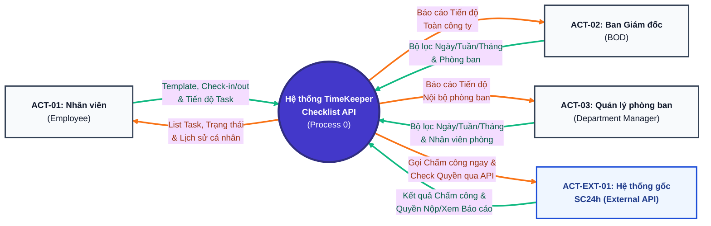

# BƯỚC 3: THIẾT KẾ SƠ ĐỒ NGỮ CẢNH (DFD LEVEL 0 — CONTEXT DIAGRAM)
> **Dự án:** Project TimeKeeper (Module Quản lý Checklist Công việc tích hợp Chấm công)  
> **Đầu vào:** [`md/analysis/2-actor-identification.md`](./2-actor-identification.md)  
> **Đầu ra phục vụ:** Bước 4 (Cây chức năng FDD & RBAC), Bước 5 (Database Design)

---

## 1. Bảng Đặc tả Actor – Hành động & Luồng Dữ liệu (Bảng 5 Cột Chuẩn hóa)

Bảng dưới đây định nghĩa toàn bộ 10 tương tác vào/ra (Input/Output) giữa 4 Actor chuẩn hóa ở Bước 2 với hệ thống **TimeKeeper API (`Process 0`)**:

| Actor | Mã | Hành động | Dữ liệu Input (Actor gửi vào) | Dữ liệu Output (Actor nhận lại) |
|---|:---:|---|---|---|
| **Nhân viên** (`ACT-01`) | `[Nhân viên - 01]` | Quản lý Template Task cá nhân | Thông tin công việc mẫu (tên task, mô tả, thao tác tạo/sửa/xóa) | Danh sách Template Task cá nhân & kết quả lưu |
| **Nhân viên** (`ACT-01`) | `[Nhân viên - 02]` | Check-in & Lập Checklist công việc trong ngày | 1. Yêu cầu Check-in đầu ngày 2. Danh sách công việc chọn từ Template hoặc tạo mới (nếu thuộc diện nộp báo cáo) | 1. Kết quả Check-in tức thời + Cờ `require_checklist` + List Template Task 2. Xác nhận lưu Checklist ngày thành công |
| **Nhân viên** (`ACT-01`) | `[Nhân viên - 03]` | Check-out & Cập nhật tiến độ công việc | 1. Yêu cầu Check-out cuối ngày 2. Dữ liệu cập nhật `% tiến độ (0-100%)` hoặc `chưa làm` cho từng task | 1. Kết quả Check-out tức thời + Cờ `require_checklist` + List task ngày hôm nay 2. Xác nhận cập nhật tiến độ thành công |
| **Nhân viên** (`ACT-01`) | `[Nhân viên - 04]` | Xem lịch sử Checklist cá nhân | Bộ lọc thời gian (từ ngày – đến ngày, tuần/tháng) | Lịch sử danh sách công việc & % tiến độ các ngày/tuần trước của bản thân |
| **Ban Giám đốc** (`ACT-02`) | `[Ban Giám đốc - 01]` | Xem công việc & tiến độ trong ngày (Toàn công ty) | Bộ lọc ngày, mã phòng ban, mã nhân viên | Danh sách công việc đang làm trong ngày & % tiến độ của nhân sự |
| **Ban Giám đốc** (`ACT-02`) | `[Ban Giám đốc - 02]` | Xem báo cáo thống kê tuần/tháng (Toàn công ty) | Bộ lọc chu kỳ (tuần/tháng), mã phòng ban | Số liệu tổng hợp khối lượng việc, tỷ lệ hoàn thành & tiến độ các phòng ban |
| **Quản lý phòng ban** (`ACT-03`) | `[Quản lý phòng ban - 01]` | Xem công việc & tiến độ trong ngày (Nội bộ phòng) | Bộ lọc ngày, mã nhân viên thuộc phòng ban quản lý | Danh sách công việc trong ngày & % tiến độ của nhân viên trong phòng |
| **Quản lý phòng ban** (`ACT-03`) | `[Quản lý phòng ban - 02]` | Xem báo cáo thống kê tuần/tháng (Nội bộ phòng) | Bộ lọc chu kỳ (tuần/tháng), mã nhân viên thuộc phòng ban | Báo cáo tổng hợp khối lượng công việc & tỷ lệ hoàn thành của phòng mình |
| **Hệ thống gốc SC24h** (`ACT-EXT-01`) | `[Hệ thống gốc - 01]` | Xử lý Check-in / Check-out tức thời | Kết quả ghi nhận thời gian Check-in / Check-out tức thời của User | Yêu cầu gọi API Check-in / Check-out tức thời ngay khi User bấm chấm công |
| **Hệ thống gốc SC24h** (`ACT-EXT-01`) | `[Hệ thống gốc - 02]` | Kiểm tra nghĩa vụ nộp Checklist & Quyền xem báo cáo | Kết quả kiểm tra cờ `require_checklist` (khi chấm công) & quyền/phạm vi xem báo cáo Checklist Task | Yêu cầu gọi API kiểm tra nghĩa vụ nộp báo cáo & quyền xem báo cáo của User |

> **Lưu ý kiến trúc về luồng tích hợp với Hệ thống gốc SC24h (`[Hệ thống gốc - 01/02]`):**  
> 1. Khi Nhân viên bấm Check-in hoặc Check-out, Backend TimeKeeper gọi **ngay lập tức** sang API chấm công của Hệ thống gốc để ghi nhận thời gian chuẩn xác, đồng thời kiểm tra qua API gốc xem User có phải nộp báo cáo Checklist hay không. Việc chọn/tạo task hoặc cập nhật % tiến độ diễn ra độc lập trên TimeKeeper.  
> 2. Khi Ban Giám đốc hoặc Quản lý phòng ban xem báo cáo, Backend TimeKeeper kiểm tra quyền và phạm vi xem thông qua API của Hệ thống gốc.

---

## 2. Sơ đồ Ngữ cảnh DFD Level 0 (Ký hiệu Yourdon–DeMarco)

- **Chú giải màu sắc luồng dữ liệu:**
  - **Mũi tên Xanh lá (`#10b981`):** Luồng dữ liệu **Input** (Actor gửi vào Hệ thống).
  - **Mũi tên Cam (`#f97316`):** Luồng dữ liệu **Output** (Hệ thống trả về cho Actor).
  - **Khối tròn Tím (`#4338ca`):** Hệ thống trung tâm (**Process 0 — Hộp đen**).

