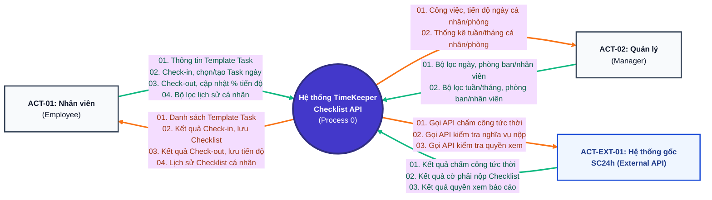

# BƯỚC 3: THIẾT KẾ SƠ ĐỒ NGỮ CẢNH (DFD LEVEL 0 — CONTEXT DIAGRAM)
> **Dự án:** Project TimeKeeper (Module Quản lý Checklist Công việc tích hợp Chấm công)  
> **Đầu vào:** [`md/analysis/2-actor-identification.md`](./2-actor-identification.md)  
> **Đầu ra phục vụ:** Bước 4 (Cây chức năng FDD & RBAC), Bước 5 (Database Design)

---

## 1. Bảng Đặc tả Actor – Hành động & Luồng Dữ liệu (Bảng 5 Cột Chuẩn hóa)

Bảng dưới đây định nghĩa toàn bộ 9 tương tác vào/ra (Input/Output) giữa 3 Actor chuẩn hóa ở Bước 2 với hệ thống **TimeKeeper API (`Process 0`)**:

| Actor | Mã | Hành động | Dữ liệu Input (Actor gửi vào) | Dữ liệu Output (Actor nhận lại) |
|---|:---:|---|---|---|
| **Nhân viên** (`ACT-01`) | `[Nhân viên - 01]` | Quản lý Template Task cá nhân | Thông tin công việc mẫu (tên task, mô tả, thao tác tạo/sửa/xóa) | Danh sách Template Task cá nhân và kết quả lưu |
| **Nhân viên** (`ACT-01`) | `[Nhân viên - 02]` | Thực hiện Check-in và lập Checklist công việc trong ngày | 1. Yêu cầu Check-in đầu ngày 2. Danh sách công việc chọn từ Template hoặc tạo mới (nếu thuộc diện nộp báo cáo) | 1. Kết quả Check-in tức thời, cờ `require_checklist` và danh sách Template Task nếu có 2. Xác nhận lưu Checklist ngày thành công |
| **Nhân viên** (`ACT-01`) | `[Nhân viên - 03]` | Thực hiện Check-out và cập nhật tiến độ công việc | 1. Yêu cầu Check-out cuối ngày 2. Dữ liệu cập nhật `% tiến độ (0-100%)` hoặc trạng thái `chưa làm` cho từng task | 1. Kết quả Check-out tức thời, cờ `require_checklist` và danh sách task ngày hôm nay nếu có 2. Xác nhận cập nhật tiến độ thành công |
| **Nhân viên** (`ACT-01`) | `[Nhân viên - 04]` | Xem lịch sử Checklist cá nhân | Bộ lọc thời gian (từ ngày – đến ngày, tuần/tháng) | Lịch sử danh sách công việc và tiến độ % các ngày/tuần trước của bản thân |
| **Quản lý** (`ACT-02`) | `[Quản lý - 01]` | Xem danh sách công việc và tiến độ trong ngày của cá nhân/ phòng ban | Bộ lọc ngày, mã phòng ban/ mã nhân viên | Danh sách công việc đang làm trong ngày và tiến độ % của nhân sự/ các nhân sự trong phòng ban |
| **Quản lý** (`ACT-02`) | `[Quản lý - 02]` | Xem báo cáo thống kê tiến độ tuần/tháng của cá nhân/ phòng ban | Bộ lọc chu kỳ (tuần/tháng), mã phòng ban, mã nhân viên | Số liệu tổng hợp khối lượng công việc, tỷ lệ hoàn thành và tiến độ |
| **Hệ thống gốc SC24h** (`ACT-EXT-01`) | `[Hệ thống gốc - 01]` | Xử lý chấm công Check-in / Check-out tức thời | Kết quả ghi nhận thời gian Check-in / Check-out tức thời của User | Yêu cầu gọi API Check-in / Check-out tức thời ngay khi User bấm chấm công |
| **Hệ thống gốc SC24h** (`ACT-EXT-01`) | `[Hệ thống gốc - 02]` | Kiểm tra nghĩa vụ nộp báo cáo Checklist | Kết quả kiểm tra cờ bắt buộc nộp báo cáo (`require_checklist`) của User | Yêu cầu gọi API kiểm tra User có phải nộp báo cáo Checklist khi chấm công không |
| **Hệ thống gốc SC24h** (`ACT-EXT-01`) | `[Hệ thống gốc - 03]` | Kiểm tra quyền xem báo cáo Checklist | Kết quả kiểm tra quyền xem báo cáo (`can_view_report`) của User | Yêu cầu gọi API kiểm tra User có quyền Quản lý xem báo cáo không |

> **Lưu ý kiến trúc về luồng tích hợp với Hệ thống gốc SC24h (`[Hệ thống gốc - 01/02/03]`):**  
> 1. Khi Nhân viên bấm Check-in hoặc Check-out, Backend TimeKeeper gọi **ngay lập tức** sang API chấm công của Hệ thống gốc (`[Hệ thống gốc - 01]`) để ghi nhận thời gian chuẩn xác, đồng thời gọi API kiểm tra nghĩa vụ nộp báo cáo (`[Hệ thống gốc - 02]`). Việc chọn/tạo task hoặc cập nhật % tiến độ diễn ra độc lập trên TimeKeeper.  
> 2. Khi Quản lý xem báo cáo ngày/tuần/tháng, Backend TimeKeeper gọi API kiểm tra quyền xem báo cáo (`[Hệ thống gốc - 03]`).

---

## 2. Sơ đồ Ngữ cảnh DFD Level 0 (Ký hiệu Yourdon–DeMarco)

- **Chú giải màu sắc luồng dữ liệu:**
  - **Mũi tên Xanh lá (`#10b981`):** Luồng dữ liệu **Input** (Actor gửi vào Hệ thống).
  - **Mũi tên Cam (`#f97316`):** Luồng dữ liệu **Output** (Hệ thống trả về cho Actor).
  - **Khối tròn Tím (`#4338ca`):** Hệ thống trung tâm (**Process 0 — Hộp đen**).

