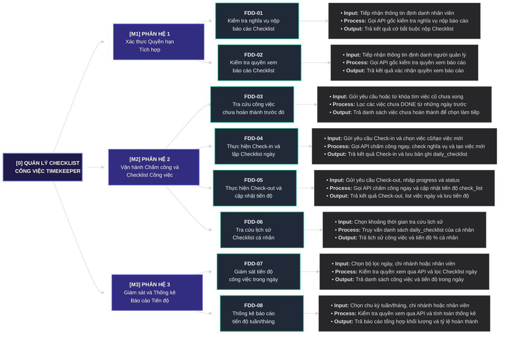

# BƯỚC 4: SƠ ĐỒ PHÂN RÃ CHỨC NĂNG (FDD 3 CẤP) & MA TRẬN RBAC
> **Dự án:** Project TimeKeeper (Module Quản lý Checklist Công việc tích hợp Chấm công)  
> **Đầu vào:** [`md/analysis/2-actor-identification.md`](./2-actor-identification.md), [`md/analysis/3-dfd-context-diagram.md`](./3-dfd-context-diagram.md)  
> **Đầu ra phục vụ:** Bước 5 (Ánh xạ FDD sang Database), Bước 6 (Thiết kế RESTful API)

---

## 1. Kiểm chứng Nguyên tắc MECE & Công thức Bảo toàn Chức năng Cấp 2

### 1.1. Công thức Bảo toàn Chức năng Cấp 2
$$\text{Tổng Chức năng Cấp 2} = \text{Tổng Hành động Actor (Bước 3)} - \text{Số Hành động trùng/hợp nhất} + \text{Số Tác vụ tự động (Bước 2)}$$

* **Tổng Hành động Actor ở Bước 3:** `9` hành động (`[Nhân viên - 01..04]`, `[Quản lý - 01..02]`, `[Hệ thống gốc - 01..03]`).
* **Số Hành động hợp nhất theo nguyên tắc MECE:** `1` điểm hợp nhất:
  * `[Hệ thống gốc - 01]` *(Xử lý chấm công Check-in / Check-out tức thời)* $\longrightarrow$ Hợp nhất vào nhịp gọi API chấm công tức thời bên trong **`FDD-04` (Thực hiện Check-in và lập Checklist ngày)** và **`FDD-05` (Thực hiện Check-out và cập nhật tiến độ)**.
* **Số Tác vụ tự động ở Bước 2:** `0` tác vụ (truy vấn và thống kê trực tiếp trên collection `daily_checklist`).

$$\Longrightarrow \text{Tổng Chức năng Cấp 2} = 9 - 1 + 0 = \mathbf{8\text{ Chức năng Cấp 2 } (\text{FDD-01} \to \text{FDD-08})}$$

---

## 2. Sơ đồ Cây Phân rã Chức năng FDD 4 Tầng (`Cấp 0 ➔ Cấp 1 ➔ Cấp 2 ➔ Cấp 3`)

---

## 3. Bảng Đặc tả Chi tiết Tác vụ Cấp 3 theo Nhịp IPO (`Input – Process – Output`)

| Mã FDD | Tên Chức năng Cấp 2 | Nhịp Input (Đầu vào) | Nhịp Process (Xử lý Nghiệp vụ) | Nhịp Output (Đầu ra) |
|:---:|---|---|---|---|
| **`FDD-01`** | **Kiểm tra nghĩa vụ nộp báo cáo Checklist** | Tiếp nhận thông tin định danh nhân viên (`employee_id`, token) khi chấm công. | Gọi sang API của Hệ thống gốc SC24h (`[Hệ thống gốc - 02]`) để kiểm tra xem nhân viên đó có thuộc diện bắt buộc nộp báo cáo Checklist khi Check-in / Check-out hay không. | Trả về cờ `require_checklist` (`true / false`). |
| **`FDD-02`** | **Kiểm tra quyền xem báo cáo Checklist** | Tiếp nhận thông tin định danh người dùng (`employee_id`, token) khi truy cập các chức năng báo cáo. | Gọi sang API của Hệ thống gốc SC24h (`[Hệ thống gốc - 03]`) để kiểm tra xem người dùng có quyền Quản lý được xem báo cáo Checklist hay không. | Trả về cờ `can_view_report` (`true / false`). |
| **`FDD-03`** | **Tra cứu công việc chưa hoàn thành trước đó** | Nhận yêu cầu lấy gợi ý hoặc từ khóa tìm kiếm công việc của nhân viên (`employee_id`) khi chuẩn bị điền Checklist đầu ngày. | Truy vấn trên `daily_checklist` của nhân viên từ những ngày trước để lọc các phần tử trong mảng `check_list` có trạng thái chưa hoàn thành (`TODO`, `PROGRESS`, `HOLD`). | Trả về danh sách các đầu việc chưa xong trước đó để nhân viên chọn tiếp tục làm (không phải gõ lại). |
| **`FDD-04`** | **Thực hiện Check-in và lập Checklist ngày** | **Pha 1:** Nhận yêu cầu Check-in đầu ngày từ nhân viên. **Pha 2:** Nhận danh sách các đầu việc (`description`) được chọn tiếp tục từ việc cũ hoặc nhập mới cho ngày hôm nay. | **Pha 1:** Gọi **ngay lập tức** API chấm công gốc (`[Hệ thống gốc - 01]`) để chốt thời gian Check-in $\to$ Gọi `FDD-01` kiểm tra nghĩa vụ nộp báo cáo. **Pha 2 (Độc lập):** Khởi tạo document mới trong `daily_checklist` (nếu chọn tiếp tục việc cũ thì tạo phần tử mới y hệt cho ngày hôm nay với `progress = 0`, `status = TODO`). | **Pha 1:** Trả kết quả Check-in tức thời, cờ `require_checklist` và danh sách gợi ý việc chưa xong (`FDD-03`). **Pha 2:** Lưu danh sách công việc ngày vào `daily_checklist`. |
| **`FDD-05`** | **Thực hiện Check-out và cập nhật tiến độ** | **Pha 1:** Nhận yêu cầu Check-out cuối ngày từ nhân viên. **Pha 2:** Nhận dữ liệu cập nhật `progress` (`0-100`) và `status` (`TODO, PROGRESS, DONE, HOLD, CANCELLED`) cho từng phần tử trong `check_list`. | **Pha 1:** Gọi **ngay lập tức** API chấm công gốc (`[Hệ thống gốc - 01]`) để chốt thời gian Check-out $\to$ Gọi `FDD-01` kiểm tra nghĩa vụ nộp báo cáo và truy vấn bản ghi `daily_checklist` hôm nay. **Pha 2 (Độc lập):** Kiểm tra tính hợp lệ (`progress` từ `0` đến `100`, `status` hợp lệ) và cập nhật mảng `check_list` của ngày hôm đó. | **Pha 1:** Trả kết quả Check-out tức thời, cờ `require_checklist` và danh sách công việc ngày hôm nay (nếu có). **Pha 2:** Cập nhật snapshot tiến độ vào `daily_checklist` và trả kết quả xác nhận. |
| **`FDD-06`** | **Tra cứu lịch sử Checklist cá nhân** | Chọn khoảng thời gian tra cứu (`fromDate`, `toDate`, tuần/tháng, phân trang) của cá nhân nhân viên. | Lọc các bản ghi trong `daily_checklist` theo `employee_id` của chính nhân viên đang đăng nhập và khoảng thời gian `date` yêu cầu. | Trả về danh sách lịch sử công việc và % tiến độ hoàn thành theo từng ngày của bản thân. |
| **`FDD-07`** | **Giám sát tiến độ công việc trong ngày** | Chọn ngày cần xem (`date`), lọc theo mã chi nhánh (`branch_id`) hoặc mã nhân viên (`employee_id`). | Gọi `FDD-02` kiểm tra quyền xem báo cáo qua API gốc (`can_view_report = true`) $\to$ Truy vấn danh sách `daily_checklist` và tiến độ các đầu việc trong ngày của cá nhân / chi nhánh. | Trả về danh sách công việc đang làm trong ngày và tiến độ % của nhân sự / các nhân sự trong chi nhánh. |
| **`FDD-08`** | **Thống kê báo cáo tiến độ tuần/tháng** | Chọn chu kỳ thống kê (tuần / tháng) và bộ lọc mã chi nhánh (`branch_id`), mã nhân viên (`employee_id`). | Gọi `FDD-02` kiểm tra quyền xem báo cáo qua API gốc (`can_view_report = true`) $\to$ Truy vấn và Aggregation trực tiếp trên `daily_checklist` để tính tổng số đầu việc, tỷ lệ theo `status` và `progress` trung bình. | Trả về số liệu tổng hợp khối lượng công việc, tỷ lệ hoàn thành và tiến độ theo tuần/tháng của cá nhân / chi nhánh. |

---

## 4. Ma trận Truy vết RBAC & Phân tách Trách nhiệm (SoD)

> **Nguyên tắc Phân quyền & Kiểm soát Truy cập:**  
> - **Nhân viên (`ACT-01`):** Chỉ thao tác trên dữ liệu Checklist của chính mình (`Scope: OWN`). Nghĩa vụ phải nộp báo cáo khi Check-in / Check-out được xác định qua `FDD-01` (`require_checklist = true`).  
> - **Quản lý (`ACT-02`):** Xem danh sách công việc trong ngày và báo cáo thống kê tiến độ tuần/tháng của cá nhân / chi nhánh ở chế độ *Read-only* khi được xác thực qua `FDD-02` (`can_view_report = true`).

| STT | Mã FDD | Tên chức năng Cấp 2 (`Động từ + Danh từ`) | Nguồn Hành động / Tác vụ (Bước 2 & 3) | Bảng DB (Bước 5) | Nhân viên (`ACT-01`) | Quản lý (`ACT-02`) | Hệ thống gốc (`EXT-01`) |
|:---:|:---:|---|---|---|---|---|---|
| 1 | **`FDD-01`** | Kiểm tra nghĩa vụ nộp báo cáo Checklist | `[Hệ thống gốc - 02]` | *(Không lưu DB - Gọi API gốc)* | **Trigger Check** | - | **Check Obligation API** |
| 2 | **`FDD-02`** | Kiểm tra quyền xem báo cáo Checklist | `[Hệ thống gốc - 03]` | *(Không lưu DB - Gọi API gốc)* | - | **Trigger Check** | **Check Permission API** |
| 3 | **`FDD-03`** | Tra cứu công việc chưa hoàn thành trước đó | `[Nhân viên - 01]` | `daily_checklist` | **View** (`OWN`) | - | - |
| 4 | **`FDD-04`** | Thực hiện Check-in và lập Checklist ngày | `[Nhân viên - 02]`, `[Hệ thống gốc - 01]` | `daily_checklist` | **Create / View** (`OWN`) | - | **Attendance API** |
| 5 | **`FDD-05`** | Thực hiện Check-out và cập nhật tiến độ | `[Nhân viên - 03]`, `[Hệ thống gốc - 01]` | `daily_checklist` | **Update / View** (`OWN`) | - | **Attendance API** |
| 6 | **`FDD-06`** | Tra cứu lịch sử Checklist cá nhân | `[Nhân viên - 04]` | `daily_checklist` | **View** (`OWN`) | - | - |
| 7 | **`FDD-07`** | Giám sát tiến độ công việc trong ngày | `[Quản lý - 01]` | `daily_checklist` | - | **View** (`can_view_report = true`) | - |
| 8 | **`FDD-08`** | Thống kê báo cáo tiến độ tuần/tháng | `[Quản lý - 02]` | `daily_checklist` | - | **View** (`can_view_report = true`) | - |
