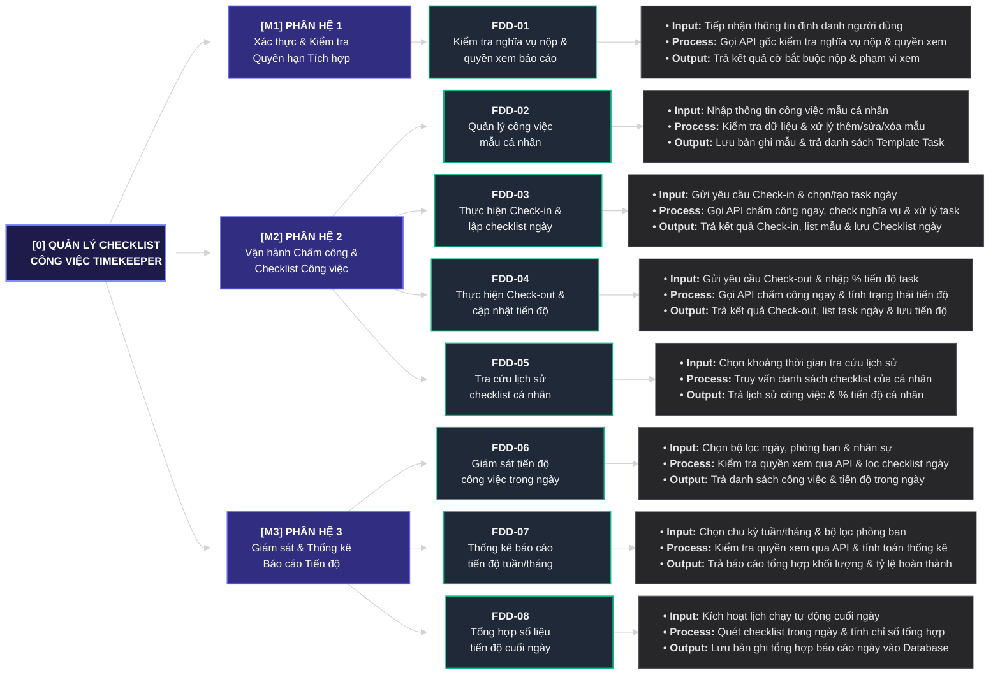

# BƯỚC 4: SƠ ĐỒ PHÂN RÃ CHỨC NĂNG (FDD 3 CẤP) & MA TRẬN RBAC
> **Dự án:** Project TimeKeeper (Module Quản lý Checklist Công việc tích hợp Chấm công)  
> **Đầu vào:** [`md/analysis/2-actor-identification.md`](./2-actor-identification.md), [`md/analysis/3-dfd-context-diagram.md`](./3-dfd-context-diagram.md)  
> **Đầu ra phục vụ:** Bước 5 (Ánh xạ FDD sang Database), Bước 6 (Thiết kế RESTful API)

---

## 1. Kiểm chứng Nguyên tắc MECE & Công thức Bảo toàn Chức năng Cấp 2

### 1.1. Công thức Bảo toàn Chức năng Cấp 2
$$\text{Tổng Chức năng Cấp 2} = \text{Tổng Hành động Actor (Bước 3)} - \text{Số Hành động trùng/hợp nhất} + \text{Số Tác vụ tự động (Bước 2)}$$

* **Tổng Hành động Actor ở Bước 3:** `10` hành động (`[Nhân viên - 01..04]`, `[Ban Giám đốc - 01..02]`, `[Quản lý phòng ban - 01..02]`, `[Hệ thống gốc - 01..02]`).
* **Số Hành động hợp nhất theo nguyên tắc MECE:** `3` điểm hợp nhất:
  1. `[Ban Giám đốc - 01]` + `[Quản lý phòng ban - 01]` $\longrightarrow$ Hợp nhất thành **`FDD-06: Giám sát tiến độ công việc trong ngày`** *(phân biệt phạm vi dữ liệu qua API Hệ thống gốc)*.
  2. `[Ban Giám đốc - 02]` + `[Quản lý phòng ban - 02]` $\longrightarrow$ Hợp nhất thành **`FDD-07: Thống kê báo cáo tiến độ tuần/tháng`** *(phân biệt phạm vi dữ liệu qua API Hệ thống gốc)*.
  3. `[Hệ thống gốc - 01]` *(Xử lý Check-in / Check-out tức thời)* $\longrightarrow$ Hợp nhất vào nhịp gọi API chấm công tức thời bên trong **`FDD-03` (Check-in)** và **`FDD-04` (Check-out)**.
* **Số Tác vụ tự động ở Bước 2:** `1` tác vụ (`JOB-01: Cron Job Tổng hợp Báo cáo Cuối ngày` $\longrightarrow$ **`FDD-08`**).

$$\Longrightarrow \text{Tổng Chức năng Cấp 2} = 10 - 3 + 1 = \mathbf{8\text{ Chức năng Cấp 2 } (\text{FDD-01} \to \text{FDD-08})}$$

---

## 2. Sơ đồ Cây Phân rã Chức năng FDD 4 Tầng (`Cấp 0 ➔ Cấp 1 ➔ Cấp 2 ➔ Cấp 3`)

---

## 3. Bảng Đặc tả Chi tiết Tác vụ Cấp 3 theo Nhịp IPO (`Input – Process – Output`)

| Mã FDD | Tên Chức năng Cấp 2 | Nhịp Input (Đầu vào) | Nhịp Process (Xử lý Nghiệp vụ) | Nhịp Output (Đầu ra) |
|:---:|---|---|---|---|
| **`FDD-01`** | **Kiểm tra nghĩa vụ nộp & quyền xem báo cáo** | Tiếp nhận token / thông tin định danh `user_id`, `group_id` từ request. | Gọi sang API của Hệ thống gốc SC24h để kiểm tra: (1) User có thuộc diện bắt buộc nộp báo cáo Checklist khi chấm công không; (2) User có quyền xem báo cáo Checklist Task và phạm vi được xem là gì. | Trả về cờ `require_checklist` (`true/false`) hoặc quyền xem báo cáo (`can_view_report`, danh sách phòng ban/nhân sự được phép xem). |
| **`FDD-02`** | **Quản lý công việc mẫu cá nhân** | Nhập thông tin Template Task (tiêu đề công việc mẫu, mô tả, thứ tự ưu tiên) hoặc yêu cầu sửa/xóa/xem. | Kiểm tra tính hợp lệ dữ liệu (`sanitizeContent`), xác thực quyền sở hữu cá nhân (`user_id`) và thực thi thao tác thêm/sửa/xóa. | Lưu cập nhật vào bảng `task_templates` và trả về danh sách Template Task cá nhân của nhân viên. |
| **`FDD-03`** | **Thực hiện Check-in & lập checklist ngày** | **Pha 1:** Nhận yêu cầu Check-in từ User. **Pha 2:** Nhận danh sách công việc chọn từ Template Task hoặc tạo task mới cho ngày hôm nay. | **Pha 1:** Gọi **ngay lập tức** API chấm công gốc để chốt thời gian Check-in $\to$ Gọi `FDD-01` kiểm tra nghĩa vụ nộp báo cáo. **Pha 2 (Độc lập):** Kiểm tra dữ liệu các đầu việc được chọn/tạo mới và khởi tạo bản ghi Checklist ngày. | **Pha 1:** Trả kết quả Check-in tức thời + cờ `require_checklist` + danh sách Template Task cá nhân. **Pha 2:** Lưu danh sách công việc ngày vào `daily_checklists` (trạng thái khởi tạo `0%`). |
| **`FDD-04`** | **Thực hiện Check-out & cập nhật tiến độ** | **Pha 1:** Nhận yêu cầu Check-out từ User. **Pha 2:** Nhận dữ liệu cập nhật `% tiến độ (0-100%)` hoặc trạng thái `chưa làm` cho từng task trong ngày. | **Pha 1:** Gọi **ngay lập tức** API chấm công gốc để chốt thời gian Check-out $\to$ Gọi `FDD-01` kiểm tra nghĩa vụ nộp báo cáo & truy vấn list task hôm nay. **Pha 2 (Độc lập):** Kiểm tra giá trị `% tiến độ`, tính toán trạng thái từng task và tỷ lệ hoàn thành chung của ngày. | **Pha 1:** Trả kết quả Check-out tức thời + cờ `require_checklist` + danh sách công việc ngày hôm nay. **Pha 2:** Cập nhật tiến độ vào `daily_checklists` và trả kết quả xác nhận. |
| **`FDD-05`** | **Tra cứu lịch sử checklist cá nhân** | Chọn khoảng thời gian tra cứu (`fromDate`, `toDate`, phân trang) của cá nhân nhân viên. | Lọc các bản ghi checklist theo `user_id` của chính nhân viên đang đăng nhập và khoảng thời gian yêu cầu. | Trả về danh sách lịch sử công việc và % tiến độ hoàn thành theo từng ngày của bản thân. |
| **`FDD-06`** | **Giám sát tiến độ công việc trong ngày** | Chọn ngày cần xem, lọc theo mã phòng ban (`group_id`), mã nhân viên hoặc trạng thái tiến độ. | Gọi `FDD-01` kiểm tra quyền và phạm vi xem báo cáo qua API gốc $\to$ Truy vấn danh sách checklist và tiến độ các đầu việc trong ngày theo đúng phạm vi được phép. | Trả về danh sách nhân sự, các công việc đang làm trong ngày và % tiến độ chi tiết. |
| **`FDD-07`** | **Thống kê báo cáo tiến độ tuần/tháng** | Chọn chu kỳ thống kê (tuần / tháng / khoảng ngày) và bộ lọc phòng ban / nhân sự. | Gọi `FDD-01` kiểm tra quyền xem báo cáo qua API gốc $\to$ Truy vấn dữ liệu tổng hợp từ `daily_report_summaries` & `daily_checklists` để tính tổng số việc, việc hoàn thành, việc dở dang/chưa làm và % trung bình. | Trả về số liệu thống kê tổng quan và chi tiết tiến độ công việc theo tuần/tháng. |
| **`FDD-08`** | **Tổng hợp số liệu tiến độ cuối ngày** | Kích hoạt tự động theo lịch Cron Job vào cuối mỗi ngày (`JOB-01`). | Quét toàn bộ dữ liệu `daily_checklists` phát sinh trong ngày, thống kê số lượng task theo trạng thái và tính điểm/tỷ lệ % tiến độ trung bình theo từng nhân viên & phòng ban. | Lưu/cập nhật bản ghi tổng hợp vào `daily_report_summaries` để tối ưu tốc độ truy vấn báo cáo tuần/tháng. |

---

## 4. Ma trận Truy vết RBAC & Phân tách Trách nhiệm (SoD)

> **Nguyên tắc Phân quyền & Kiểm soát Truy cập:**  
> - **Nhân viên (`ACT-01`):** Chỉ thao tác trên dữ liệu Template Task và Checklist của chính mình (`Scope: OWN`). Nghĩa vụ phải nộp báo cáo khi Check-in/Check-out được quyết định qua API Hệ thống gốc (`FDD-01`).  
> - **Ban Giám đốc (`ACT-02`) & Quản lý phòng ban (`ACT-03`):** Chỉ có quyền xem báo cáo (*Read-only*). Quyền được phép truy cập báo cáo và phạm vi dữ liệu (`ALL` toàn công ty hay `DEPARTMENT` nội bộ phòng) được xác thực qua API Hệ thống gốc (`FDD-01`).

| STT | Mã FDD | Tên chức năng Cấp 2 (`Động từ + Danh từ`) | Nguồn Hành động / Tác vụ (Bước 2 & 3) | Bảng DB dự kiến (Bước 5) | Nhân viên (`ACT-01`) | Ban Giám đốc (`ACT-02`) | Quản lý phòng (`ACT-03`) | Hệ thống gốc (`EXT-01`) | Hệ thống (`Cron`) |
|:---:|:---:|---|---|---|---|---|---|---|---|
| 1 | **`FDD-01`** | Kiểm tra nghĩa vụ nộp & quyền xem báo cáo | `[Hệ thống gốc - 02]` | *(Không lưu DB - Gọi API gốc)* | **Trigger Check** | **Trigger Check** | **Trigger Check** | **Permission API** | - |
| 2 | **`FDD-02`** | Quản lý công việc mẫu cá nhân | `[Nhân viên - 01]` | `task_templates` | **CRUD** (`OWN`) | - | - | - | - |
| 3 | **`FDD-03`** | Thực hiện Check-in & lập checklist ngày | `[Nhân viên - 02]`, `[Hệ thống gốc - 01]` | `daily_checklists`, `task_templates` | **Create / View** (`OWN`) | - | - | **Attendance API** | - |
| 4 | **`FDD-04`** | Thực hiện Check-out & cập nhật tiến độ | `[Nhân viên - 03]`, `[Hệ thống gốc - 01]` | `daily_checklists` | **Update / View** (`OWN`) | - | - | **Attendance API** | - |
| 5 | **`FDD-05`** | Tra cứu lịch sử checklist cá nhân | `[Nhân viên - 04]` | `daily_checklists` | **View** (`OWN`) | - | - | - | - |
| 6 | **`FDD-06`** | Giám sát tiến độ công việc trong ngày | `[Ban Giám đốc - 01]`, `[Quản lý phòng ban - 01]` | `daily_checklists` | - | **View** (`API Scope: ALL`) | **View** (`API Scope: DEPT`) | **Verify Scope** | - |
| 7 | **`FDD-07`** | Thống kê báo cáo tiến độ tuần/tháng | `[Ban Giám đốc - 02]`, `[Quản lý phòng ban - 02]` | `daily_report_summaries`, `daily_checklists` | - | **View** (`API Scope: ALL`) | **View** (`API Scope: DEPT`) | **Verify Scope** | - |
| 8 | **`FDD-08`** | Tổng hợp số liệu tiến độ cuối ngày | `JOB-01` (Bước 2) | `daily_checklists`, `daily_report_summaries` | - | - | - | - | **Auto Execute** (`CRON`) |

