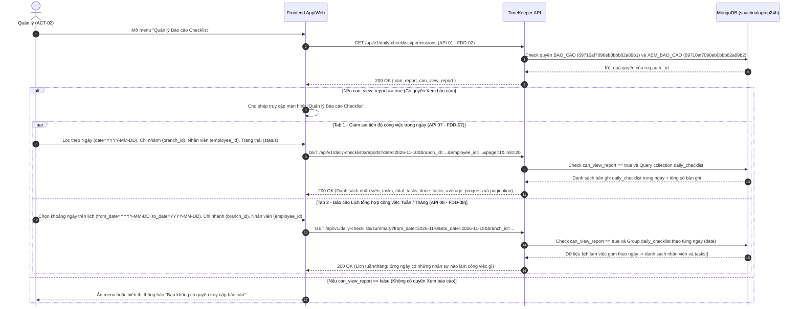

# BƯỚC 6: KỊCH BẢN LUỒNG GỌI API (FE-FIRST) & ĐẶC TẢ RESTFUL API
> **Dự án:** Project TimeKeeper (Module Quản lý & Xem Báo cáo Checklist Công việc)  
> **Phạm vi phụ trách:** Luồng Kiểm tra Quyền & Quản lý Xem Báo cáo (`FDD-01`, `FDD-02`, `FDD-07`, `FDD-08` — tương ứng `API 01`, `API 07`, `API 08`)  
> **Đầu vào:**  
> - [`md/analysis/4-fdd-and-rbac.md`](./4-fdd-and-rbac.md) (Cây chức năng FDD & Ma trận RBAC)  
> - [`md/analysis/5-database-design.md`](./5-database-design.md) (Thiết kế Collection `daily_checklist`)  
> - [`md/api/permission-function.md`](../api/permission-function.md) (Logic kiểm tra quyền `can_report` & `can_view_report`)  
> - [`md/api/jwt_token_info.md`](../api/jwt_token_info.md) (Cấu trúc `req.auth` giải mã từ JWT Access Token)

---

## PHẦN 0: KỊCH BẢN LUỒNG GỌI API THEO MÀN HÌNH (FE-FIRST SEQUENCE SCENARIO)

### Kịch bản: Luồng Quản lý Xem Báo cáo Giám sát Ngày & Lịch Tổng hợp Tuần/Tháng (`FDD-02`, `FDD-07`, `FDD-08`)

<details>
<summary>▶ <b>Nhấn để xem / thu gọn Sơ đồ Luồng gọi API (Sequence Diagram)</b></summary>



</details>

---

> **Ghi chú Xác thực & Định danh đặc thù của dự án SC24h ([`auth_middleware.js`](../api/auth_middleware.js) & [`jwt_token_info.md`](../api/jwt_token_info.md)):**
> - **Truyền Token:** Gửi qua Header `token: <jwt_token>` (không có tiền tố `Bearer `) hoặc Cookie `token=<jwt_token>`.
> - **Định danh tự động (`req.auth`):** Middleware `requireAuthAPI` tự động giải mã và gắn `employee_id = req.auth._id`, `branch_id = req.auth.branch_id`, `group_user_id = req.auth.group_user_id`.
> - **Phân quyền (`Guard`):** Kiểm tra trực tiếp trên DB theo 2 mã `function_id` tại [`permission-function.md`](../api/permission-function.md): Báo cáo (`69710af7090eb0bbb82a89b1` $\to$ `can_report`) và Xem báo cáo (`69710af7090eb0bbb82a89b2` $\to$ `can_view_report`).

---

## MỤC 1: BẢNG DANH SÁCH TỔNG HỢP API

> **Lưu ý Thứ tự Khai báo Route trong NestJS Controller:** Các route tĩnh (`/permissions`, `/reports`, `/summary`) **bắt buộc đặt phía trên** bất kỳ route động `/:id` nào.

| Mã API | HTTP Method | Endpoint URI | Chức năng Nghiệp vụ (Mã FDD) | Quyền Truy cập (Guard) |
|:---:|:---:|---|---|:---:|
| **API 01** | `GET` | `/api/v1/daily-checklists/permissions` | Kiểm tra nghĩa vụ nộp báo cáo (`can_report`) và quyền xem báo cáo (`can_view_report`) (`FDD-01`, `FDD-02`) | `requireAuthAPI` (`req.headers.token`) |
| **API 07** | `GET` | `/api/v1/daily-checklists/reports` | Quản lý giám sát danh sách công việc & tiến độ trong ngày theo chi nhánh / nhân viên (`FDD-07`) | `requireAuthAPI` + `can_view_report = true` (`69710af7090eb0bbb82a89b2`) |
| **API 08** | `GET` | `/api/v1/daily-checklists/summary` | Quản lý xem báo cáo tổng hợp dạng Lịch tuần/tháng (từng ngày trên lịch ai làm công việc gì) (`FDD-08`) | `requireAuthAPI` + `can_view_report = true` (`69710af7090eb0bbb82a89b2`) |

---

## MỤC 2: ĐẶC TẢ CHI TIẾT TỪNG API

---

### API 01: Kiểm tra Quyền Báo cáo & Xem Báo cáo (`FDD-01`, `FDD-02`)
- **Method & Endpoint:** `GET /api/v1/daily-checklists/permissions`
- **Quyền truy cập:** Yêu cầu đăng nhập qua middleware `requireAuthAPI` (`req.headers.token` hoặc `req.cookies.token`). Tự động lấy `employee_id = req.auth._id`.
- **Query Parameters:** Không có.
- **Logic xử lý tại Service:**
  1. Kiểm tra bản ghi trong collection `Employee` với `_id = ObjectId(req.auth._id)` và `Status === "Đang hoạt động"`.
  2. Kiểm tra song song (`Promise.all`) trên 2 bảng `permissions` (theo `ID_GroupUser`) và `permissionemployees` (theo `id_employee`) với 2 mã `function_id`:
     - `69710af7090eb0bbb82a89b1` $\longrightarrow$ `can_report` (`Boolean`)
     - `69710af7090eb0bbb82a89b2` $\longrightarrow$ `can_view_report` (`Boolean`)
- **Response `200 OK`:**
```json
{
  "data": {
    "employee_id": "64f926eb1d222677f7242a8d",
    "can_report": true,
    "can_view_report": true
  }
}
```
- **Mã lỗi có thể xảy ra:**
  - `401 Unauthorized`: Thiếu hoặc hết hạn Token (`{ "success": false, "message": "Unauthorized" }` hoặc `"Hết phiên đăng nhập"`).

---

### API 07: Quản lý Giám sát Tiến độ Công việc trong Ngày (`FDD-07`)
- **Method & Endpoint:** `GET /api/v1/daily-checklists/reports`
- **Quyền truy cập:** **Quản lý (`ACT-02`)** — Bắt buộc có quyền `can_view_report = true` (`function_id = 69710af7090eb0bbb82a89b2`). Nếu không có quyền trả lỗi `403 Forbidden`.
- **Query Parameters (`snake_case`):**

| Tham số | Kiểu dữ liệu | Bắt buộc | Mặc định | Mô tả & Điều kiện Validate |
|---|---|:---:|---|---|
| `date` | `String (YYYY-MM-DD)` | Không | Ngày hôm nay | Ngày cần giám sát công việc theo chuẩn ISO 8601 (ví dụ: `2026-11-10`). |
| `branch_id` | `String (ObjectId)` | Không | Tất cả / Theo phân quyền | Lọc theo chi nhánh (`branch_id`). |
| `employee_id` | `String (ObjectId)` | Không | Tất cả | Lọc theo nhân viên cụ thể (`employee_id`). |
| `status` | `String` | Không | Tất cả | Lọc các bản ghi có chứa công việc mang trạng thái `TODO, PROGRESS, DONE, HOLD, CANCELLED`. |
| `page` | `Number` | Không | `1` | Trang hiện tại (`page >= 1`). |
| `limit` | `Number` | Không | `20` | Số bản ghi mỗi trang (`1 <= limit <= 100`). |

- **Logic xử lý tại Service:**
  1. Kiểm tra quyền `hasPermission(db, req.auth._id, '69710af7090eb0bbb82a89b2')`. Nếu `false` $\longrightarrow$ ném lỗi `403 Forbidden`.
  2. Lọc các bản ghi trong `daily_checklist` theo khoảng `startOfDay(date)` $\to$ `endOfDay(date)`, kết hợp điều kiện lọc `branch_id` và `employee_id` (nếu có).
  3. Join (`$lookup`) với bảng `Employee` và `Branch` để trả kèm tên nhân viên (`employee_name`) và tên chi nhánh (`branch_name`), đồng thời tính `total_tasks`, `done_tasks` và `average_progress` của từng nhân viên trong ngày hôm đó.
- **Response `200 OK`:**
<details>
<summary>▶ <b>Nhấn để xem / thu gọn JSON Response mẫu (200 OK)</b></summary>

```json
{
  "data": {
    "items": [
      {
        "_id": "67301b20d9f1a23c44b201a0",
        "employee_id": "64f926eb1d222677f7242a8d",
        "employee_name": "Nguyễn Huy Hoàng",
        "branch_id": "61518fd3d095e16792ce6cc5",
        "branch_name": "Văn phòng 24h Group",
        "date": "2026-11-10T01:30:00.000Z",
        "total_tasks": 3,
        "done_tasks": 2,
        "average_progress": 86.67,
        "tasks": [
          {
            "_id": "67301b20d9f1a23c44b201a1",
            "content": "Kiểm tra tồn kho linh kiện màn hình iPhone 14",
            "progress": 100,
            "status": "DONE"
          },
          {
            "_id": "67301b20d9f1a23c44b201a2",
            "content": "Lập báo cáo xuất nhập tồn đầu tuần",
            "progress": 60,
            "status": "PROGRESS"
          },
          {
            "_id": "67309f88d9f1a23c44b201a9",
            "content": "Hỗ trợ kiểm kê đột xuất kho chi nhánh Cầu Giấy",
            "progress": 100,
            "status": "DONE"
          }
        ]
      }
    ],
    "pagination": {
      "page": 1,
      "limit": 20,
      "total": 1,
      "total_pages": 1
    }
  }
}
```

</details>
- **Mã lỗi có thể xảy ra:**
  - `400 Bad Request`: Sai định dạng `date` (`YYYY-MM-DD`), `branch_id`, `employee_id` hoặc `status`.
  - `401 Unauthorized`: Thiếu hoặc hết hạn Token.
  - `403 Forbidden`: Người dùng không có quyền `Xem báo cáo` (`69710af7090eb0bbb82a89b2`).

---

### API 08: Báo cáo Tổng hợp Lịch Công việc Tuần / Tháng (`FDD-08`)
- **Method & Endpoint:** `GET /api/v1/daily-checklists/summary`
- **Quyền truy cập:** **Quản lý (`ACT-02`)** — Bắt buộc có quyền `can_view_report = true` (`function_id = 69710af7090eb0bbb82a89b2`).
- **Query Parameters (`snake_case`):**

| Tham số | Kiểu dữ liệu | Bắt buộc | Mặc định | Mô tả & Điều kiện Validate |
|---|---|:---:|---|---|
| `from_date` | `String (YYYY-MM-DD)` | Có | - | Ngày bắt đầu trên lịch theo chuẩn ISO 8601 (ví dụ: `2026-11-09`). |
| `to_date` | `String (YYYY-MM-DD)` | Có | - | Ngày kết thúc trên lịch (`to_date >= from_date`, ví dụ: `2026-11-15`). |
| `branch_id` | `String (ObjectId)` | Không | Tất cả | Lọc theo chi nhánh (`branch_id`). |
| `employee_id` | `String (ObjectId)` | Không | Tất cả | Lọc theo 1 nhân viên cụ thể (`employee_id`). |
| `status` | `String` | Không | Tất cả | Lọc các công việc theo trạng thái (`TODO, PROGRESS, DONE, HOLD, CANCELLED`). |

- **Logic xử lý tại Service:**
  1. Kiểm tra quyền `can_view_report = true` (`69710af7090eb0bbb82a89b2`). Nếu `false` $\longrightarrow$ trả lỗi `403 Forbidden`.
  2. Truy vấn collection `daily_checklist` trong khoảng `startOfDay(from_date)` $\to$ `endOfDay(to_date)`, kết hợp điều kiện lọc `branch_id`, `employee_id` và `status` (nếu có).
  3. Gom nhóm (`$group`) dữ liệu theo **từng ngày làm việc trên lịch (`date`: `YYYY-MM-DD`)** sắp xếp tăng dần/giảm dần theo thời gian:
     - Mỗi phần tử trong mảng trả về đại diện cho **1 ô Ngày trên Lịch (`date`)**.
     - Bên trong mỗi ngày là mảng **`employees`** liệt kê các nhân sự có làm việc trong ngày hôm đó kèm danh sách **`tasks[]`** (`_id`, `content`, `progress`, `status`) của từng người.
     - Không cộng dồn tổng số task giữa các ngày (vì một công việc kéo dài nhiều ngày sẽ xuất hiện ở nhiều bản ghi ngày khác nhau với `_id` khác nhau).
- **Response `200 OK`:**
<details>
<summary>▶ <b>Nhấn để xem / thu gọn JSON Response mẫu (200 OK)</b></summary>

```json
{
  "data": {
    "from_date": "2026-11-09",
    "to_date": "2026-11-15",
    "items": [
      {
        "date": "2026-11-09",
        "employees": [
          {
            "checklist_id": "672f1a90c8e2b41d88a102a0",
            "employee_id": "64f926eb1d222677f7242a8d",
            "employee_name": "Nguyễn Huy Hoàng",
            "branch_id": "61518fd3d095e16792ce6cc5",
            "branch_name": "Văn phòng 24h Group",
            "tasks": [
              {
                "_id": "672f1a90c8e2b41d88a102b1",
                "content": "Kiểm tra tồn kho linh kiện màn hình iPhone 14",
                "progress": 40,
                "status": "PROGRESS"
              },
              {
                "_id": "672f1a90c8e2b41d88a102b2",
                "content": "Đối soát phiếu nhập kho nhà cung cấp miền Bắc",
                "progress": 0,
                "status": "HOLD"
              }
            ]
          },
          {
            "checklist_id": "672f1a90c8e2b41d88a102c0",
            "employee_id": "651a38fc2e333788a8353b9e",
            "employee_name": "Trần Minh Tuấn",
            "branch_id": "61518fd3d095e16792ce6cc5",
            "branch_name": "Văn phòng 24h Group",
            "tasks": [
              {
                "_id": "672f1a90c8e2b41d88a102c1",
                "content": "Viết API giám sát tiến độ công việc trong ngày",
                "progress": 50,
                "status": "PROGRESS"
              }
            ]
          }
        ]
      },
      {
        "date": "2026-11-10",
        "employees": [
          {
            "checklist_id": "67301b20d9f1a23c44b201a0",
            "employee_id": "64f926eb1d222677f7242a8d",
            "employee_name": "Nguyễn Huy Hoàng",
            "branch_id": "61518fd3d095e16792ce6cc5",
            "branch_name": "Văn phòng 24h Group",
            "tasks": [
              {
                "_id": "67301b20d9f1a23c44b201a1",
                "content": "Kiểm tra tồn kho linh kiện màn hình iPhone 14",
                "progress": 100,
                "status": "DONE"
              },
              {
                "_id": "67301b20d9f1a23c44b201a2",
                "content": "Lập báo cáo xuất nhập tồn đầu tuần",
                "progress": 60,
                "status": "PROGRESS"
              }
            ]
          },
          {
            "checklist_id": "67301b20d9f1a23c44b201b0",
            "employee_id": "651a38fc2e333788a8353b9e",
            "employee_name": "Trần Minh Tuấn",
            "branch_id": "61518fd3d095e16792ce6cc5",
            "branch_name": "Văn phòng 24h Group",
            "tasks": [
              {
                "_id": "67301b20d9f1a23c44b201b1",
                "content": "Viết API giám sát tiến độ công việc trong ngày",
                "progress": 100,
                "status": "DONE"
              },
              {
                "_id": "67301b20d9f1a23c44b201b2",
                "content": "Tối ưu truy vấn báo cáo lịch tuần/tháng",
                "progress": 30,
                "status": "PROGRESS"
              }
            ]
          }
        ]
      }
    ]
  }
}
```

</details>
- **Mã lỗi có thể xảy ra:**
  - `400 Bad Request`: Thiếu `from_date` / `to_date`, sai định dạng `YYYY-MM-DD`, `to_date < from_date`, hoặc sai định dạng `ObjectId`.
  - `401 Unauthorized`: Thiếu hoặc hết hạn Token.
  - `403 Forbidden`: Người dùng không có quyền `Xem báo cáo` (`69710af7090eb0bbb82a89b2`).

---

## MỤC 3: BẢNG TỔNG HỢP MÃ LỖI (`400 / 401 / 403`)

| HTTP Status | Mã Lỗi (`error.code`) | Ngữ cảnh Xảy ra |
|:---:|---|---|
| `400 Bad Request` | `VALIDATION_ERROR` | Dữ liệu Query Params không hợp lệ (`from_date > to_date`, sai định dạng ngày `YYYY-MM-DD` hoặc sai định dạng `ObjectId` cho `branch_id`, `employee_id`). |
| `401 Unauthorized` | `UNAUTHORIZED` | Không gửi kèm Header/Cookie `token` hoặc Token không tồn tại / hết hạn trong bảng `UserToken`. |
| `403 Forbidden` | `FORBIDDEN_REPORT_ACCESS` | Gọi API Giám sát ngày (`API 07`) hoặc Tổng hợp lịch tuần/tháng (`API 08`) nhưng tài khoản không được cấp quyền `Xem báo cáo` (`69710af7090eb0bbb82a89b2`) hoặc nhân viên không ở trạng thái `"Đang hoạt động"`. |
